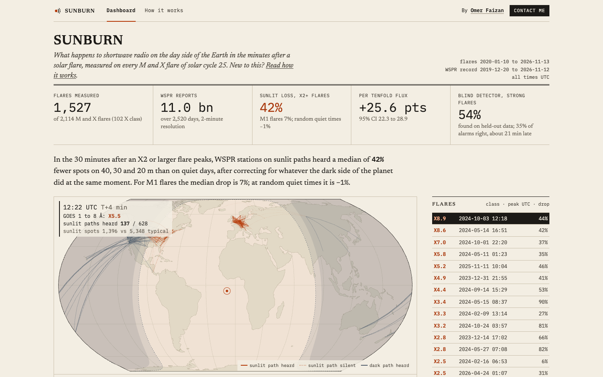

# Sunburn

When a solar flare goes off, its X-rays reach Earth in about eight minutes and thicken the lowest layer of the ionosphere on the day side. For a while that layer soaks up shortwave radio instead of letting it reflect, and long-distance signals fade out. Radio operators call it a shortwave fade-out.

I measured that effect for every M and X class flare of solar cycle 25 using WSPR, a network of amateur radio stations that send and log weak test signals around the clock. Then I built a detector that sees only the radio data, never the X-ray data, and scored it against NOAA's official flare list on a period it was not tuned on.



## The site

- **Dashboard** (`/`): headline figures; a replay map of every radio path during the 20 largest flares, with the X-ray curve and spot counts underneath; the whole cycle month by month; the same flare band by band; dose and response for all measured flares; the frequency signature; and the detector's held-out scorecard.
- **How it works** (`/how-it-works/`): what a flare does to radio, what WSPR is, the measurement in four steps, the checks that the effect is real, how the detector is graded, where the data comes from, its limits, and the full technical method. Written for readers with no radio background.

## Results

Data: 10.96 billion WSPR spots over 2,520 days (2019-12-20 to 2026-11-12), and 2,114 flares from NOAA's GOES flare list (2,012 M class, 102 X class). 1,527 flares were measured cleanly; 579 were excluded because another M or X flare happened in the hour before, and 8 had no WSPR data.

**How big is the fade-out.** In the 30 minutes after an X2 or larger flare peaks, stations on sunlit paths heard a median of 42% fewer spots on 40, 30 and 20 m than on quiet days, after subtracting whatever the dark side of the planet did at the same moment. For M1 flares the median drop is 7%. At 400 random quiet times, measured the same way, it is about 1% the other way.

**It scales with flare strength.** A least-squares fit gives 25.6 percentage points of extra drop for every tenfold increase in peak X-ray flux (95% bootstrap interval 22.3 to 28.9). Median drop by class:

| Peak flux | Flares | Median drop |
| --- | --- | --- |
| M1 to M2 | 951 | 7% |
| M2 to M5 | 378 | 15% |
| M5 to X1 | 127 | 23% |
| X1 to X2 | 52 | 32% |
| X2 and above | 19 | 42% |

Only 0.75% of the random quiet times showed a drop as large as the median X-class flare.

**Lower bands suffer more.** For X flares the median drop is 57% on 80 m, then 40% on 40 m, 39% on 30 m, 34% on 20 m, and 27% on 10 m. That is the direction absorption predicts (it falls roughly with the square of frequency), although the slope is much shallower than that. My reading is that WSPR measures whether a signal was decoded at all, not how much it weakened, so it saturates. (60 m had only 7 usable X flares and is left out.)

**The blind detector.** It sees only WSPR counts. Every 2 minutes it compares sunlit 40/30/20 m spots with the same minutes over the previous seven days, divides by the same ratio for dark paths, then divides by its own median over the preceding hour, so it asks whether the sunlit side just fell rather than whether it is low today. It raises an alarm when that stays low for several cycles. Its settings were chosen on 2024 and it was scored once on 2025-01-01 to 2026-11-12:

| Target | Period | Hits | False alarms | Missed | Precision | Recall | F1 | Median delay |
| --- | --- | --- | --- | --- | --- | --- | --- | --- |
| Every M1+ flare | tuning (2024) | 238 | 608 | 678 | 28.1% | 26.0% | 0.27 | 18 min |
| Every M1+ flare | **held out** | 178 | 1,278 | 423 | 12.2% | 29.6% | 0.17 | 19 min |
| R2+ flares (M5 and up) | tuning (2024) | 74 | 54 | 57 | 57.8% | 56.5% | 0.57 | 19.5 min |
| R2+ flares (M5 and up) | **held out** | 44 | 82 | 38 | 34.9% | 53.7% | 0.42 | 20.5 min |

Honestly: as a general flare alarm it is weak, and its precision fell a lot on the held-out period. For the strong flares that actually disrupt radio it finds about half of them, about 20 minutes after they start. I kept the 2024 settings rather than re-tuning on the held-out period, so these numbers are what it would have done live.

## How it works

1. **Flare list.** NOAA NCEI's GOES-R XRS L2 flare summary (version 2-2-2): GOES-16 up to 2025-04-07, GOES-19 after, matching which satellite NOAA used as primary. One-minute X-ray flux comes from the same mission files.
2. **Spots.** wspr.live is a public ClickHouse mirror of the WSPRnet database. Each query aggregates on their server into 2-minute counts by band and by the solar zenith angle at the path's great-circle midpoint, in 15 degree steps, so about 4.3 million spots a day arrive as a small table. The zenith formula (NOAA Solar Calculator, after Meeus) runs as SQL there and is unit tested against a Python version here.
3. **Sunlit and dark.** A path counts as sunlit when the Sun is above the horizon at its midpoint. This is a simplification: a long path crosses several regions.
4. **Baseline.** For each flare, the five nearest days on each side that had no M or X flare within 3 hours of the same clock time. The baseline for each 2-minute cycle is the median across those ten days: same clock time handles the daily cycle, nearby days handle season and the slow growth of WSPR.
5. **The drop.** Spots relative to baseline, summed over 30 minutes from the peak, compared with the hour before the flare, on each side. Drop = 1 minus sunlit ratio over dark ratio, so a WSPR-wide upload gap or a geomagnetic storm that hits both sides cancels out.
6. **Placebo.** 400 random times with no M or X flare within 3 hours, measured exactly the same way.
7. **Detector.** Described above; its grid of 96 settings and the selection rule (best F1 on 2024, ties to higher precision) are in `scripts/run_eval.py`.

## Limits

- wspr.live has gaps: on 488 days, mostly October 2023 to May 2025, it is missing the first minutes of each hour. Those cycles are skipped, not filled.
- WSPR stations are mostly in Europe and North America, so a flare that peaks at 03:00 UTC is measured on relatively few sunlit paths.
- High-latitude geomagnetic storms can hit sunlit and dark paths unevenly, which the dark-side correction does not fully remove.
- Prior work: Frissell and colleagues in HamSCI have published flare fade-outs in amateur radio spot data, including WSPR. This project repeats that kind of measurement across a whole cycle and adds a detector with a held-out score.

## Running it

Requirements: [uv](https://docs.astral.sh/uv/), Node 20 or newer.

```bash
make setup      # Python 3.12 venv and web dependencies
make data       # flare list, GOES files and about 2,500 daily WSPR aggregates (cached; polite to wspr.live)
make featured   # map and band detail for the 20 largest clean flares
make eval       # every number on the page -> web/public/data/results.json
make test       # unit tests (solar geometry, baseline, scoring, SQL)
make web        # http://localhost:3101
```

`make build` writes a static site to `web/out/`.

## Author

Built by Omer Faizan. More of my work is at [omerfaizan.com](https://omerfaizan.com).
